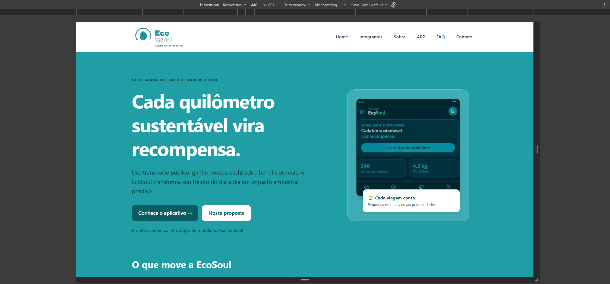
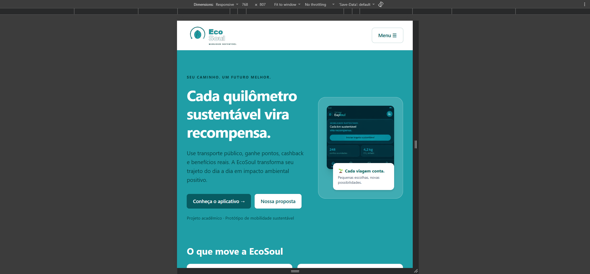
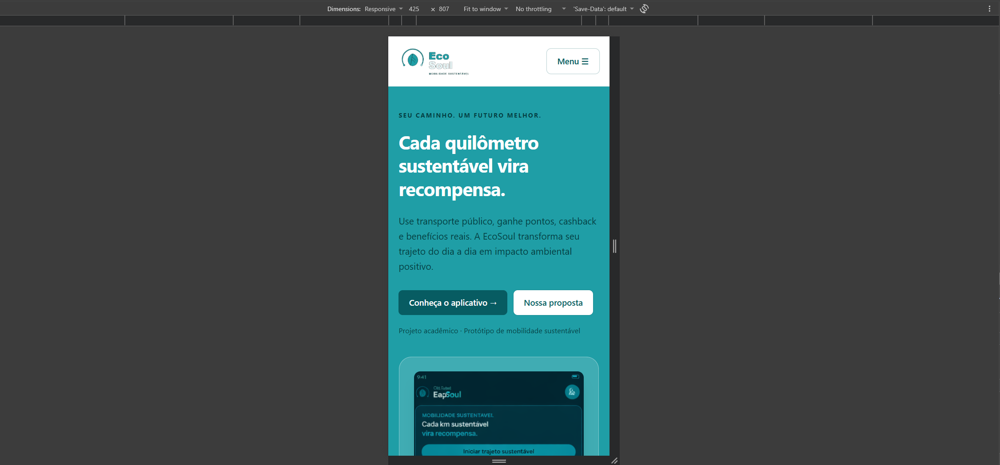

# EcoSoul — Challenge SoulUp | Sprint 4

<p align="center">
  
</p>

## Descrição do projeto

A EcoSoul é uma ideia de app para incentivar as pessoas a usar ônibus, metrô e trem. A proposta é que cada viagem gere ECO Points, que poderão ser trocados por benefícios. O app também mostraria o quanto essas viagens ajudam a reduzir a emissão de CO₂.

Fizemos este projeto para a matéria de **Front-End Design Engineering**, no Challenge SoulUp da FIAP. O site é uma SPA em **React + Vite + TypeScript**, estilizada com Tailwind. Na Sprint 4, o front-end passa a consumir a API Java desenvolvida na matéria de Domain Driven Design e fica publicado na Vercel.

## O que funciona por enquanto

No site, dá para conhecer a ideia da EcoSoul, ver os integrantes, tirar dúvidas no FAQ e acessar a página de contato. O menu, as perguntas do FAQ, a validação do formulário e os avisos de redirecionamento já funcionam.

Na página **Calculadora**, o site se conecta à API Java da matéria de Domain Driven Design: o usuário informa um trajeto de ônibus, metrô ou trem e a API calcula o CO₂ economizado, os pontos e o cashback. Os cálculos ficam salvos no banco Oracle e podem ser listados, vistos em detalhe, editados e excluídos pelo site.

## Tecnologias utilizadas

| Tecnologia | Para que usamos |
| --- | --- |
| React | Montar as páginas e reaproveitar componentes |
| Vite | Rodar o site e gerar a versão final |
| TypeScript | Definir os tipos dos dados e das props |
| Tailwind CSS | Estilizar o site e ajustar para diferentes telas |
| React Router DOM | Trocar de página sem recarregar o site e criar rotas |
| React Hook Form | Controlar o formulário e conferir os campos |
| Fetch API | Fazer as requisições HTTP para a API Java (sem Axios) |
| Context API (`useContext`) | Compartilhar os avisos (redirecionamentos e respostas da API) entre as páginas |
| Vercel | Publicar o site na nuvem |
| Oxlint | Verificar possíveis problemas no código |
| Git e GitHub | Salvar o histórico e organizar o trabalho do grupo |

## Estrutura de pastas

```text
Challenge_SoulUp/
├── .git/                       # Histórico Git
├── README.md                   # Documentação
├── img/                        # Prints do site
│   ├── computador.png
│   ├── tablet.png
│   └── celular.png
└── EcoSoul/                    # Aplicação React
    ├── public/
    │   └── img/                # Logo, fotos e protótipos
    ├── src/
    │   ├── components/
    │   │   ├── Aviso/          # Mensagem de feedback (sucesso, erro, info)
    │   │   ├── Botao/
    │   │   ├── Cabecalho/
    │   │   ├── CampoFormulario/
    │   │   ├── Card/
    │   │   ├── CardFuncionalidade/
    │   │   ├── EstadoApi/      # Mensagens de carregando e erro da API
    │   │   ├── FormularioCalculo/  # Formulário de cadastro e edição de cálculos
    │   │   ├── Menu/
    │   │   ├── PerguntaFaq/
    │   │   ├── Rodape/
    │   │   └── TituloPagina/
    │   ├── contexto/
    │   │   ├── AvisoContexto.ts    # Contexto e hook useAviso
    │   │   └── AvisoProvider.tsx   # Provider dos avisos
    │   ├── css/
    │   │   └── main.css        # Importação e configuração do Tailwind
    │   ├── dados/
    │   │   ├── calculos.ts     # Nomes dos transportes e formatação de valores
    │   │   ├── faq.ts
    │   │   ├── project.ts
    │   │   └── tipos.ts        # Interfaces, union e intersection types
    │   ├── hooks/
    │   │   └── useRequisicao.ts    # Estado de carregando/erro/sucesso
    │   ├── services/
    │   │   ├── api.ts          # Função base de requisição (fetch) e erros
    │   │   └── calculos.ts     # Endpoints /calculos da API Java
    │   ├── pages/
    │   │   ├── Calculadora/
    │   │   ├── CalculoDetalhe/
    │   │   ├── Contato/
    │   │   ├── Faq/
    │   │   ├── Funcionalidade/
    │   │   ├── Home/
    │   │   ├── Integrantes/
    │   │   ├── NaoEncontrada/
    │   │   ├── Sobre/
    │   │   └── Solucao/
    │   ├── App.tsx             # Layout compartilhado
    │   ├── main.tsx            # Entrada e configuração das rotas
    │   └── vite-env.d.ts       # Tipagem das variáveis de ambiente
    ├── .env.example            # Modelo da variável VITE_API_URL
    ├── .gitignore
    ├── .oxlintrc.json
    ├── index.html
    ├── package.json
    ├── package-lock.json
    ├── tsconfig.json
    ├── tsconfig.app.json
    ├── tsconfig.node.json
    ├── vercel.json             # Faz as rotas da SPA funcionarem na Vercel
    └── vite.config.ts
```

## Como rodar o projeto

### O que precisa ter instalado

Você precisa do Node.js e do npm para rodar o site. O Vite usado neste projeto aceita Node.js 20 a partir da versão 20.19, ou versões a partir da 22.12. Na conferência local, estavam instalados Node.js 24.19.0 e npm 11.17.0. Para baixar pelo comando abaixo, também precisa do Git.

### Pelo GitHub

Baixe a branch `main`, entre na pasta do projeto e rode os comandos:

```bash
git clone --branch main https://github.com/Giovanni0403/Challenge_SoulUp.git
cd Challenge_SoulUp/EcoSoul
npm i
npm run dev
```

Abra no navegador o endereço que aparecer no terminal, normalmente `http://localhost:5173`. O site precisa ser iniciado pelo Vite; abrir o `index.html` direto não é suficiente. Para parar o servidor, pressione `Ctrl+C` no terminal.

### Pelo ZIP

Descompacte o ZIP e abra o terminal na pasta `EcoSoul`, onde está o `package.json`:

```bash
npm i
npm run dev
```

Se o PowerShell bloquear o `npm.ps1`, use `npm.cmd i` e `npm.cmd run dev`.

### URL da API

O site lê a URL da API Java da variável `VITE_API_URL`. Para rodar localmente, copie o arquivo `.env.example` para `.env.local` (ele já traz a URL da API publicada). Na Vercel, a mesma variável fica em **Settings > Environment Variables**.

A API fica hospedada no plano gratuito do Render, que desliga o servidor quando não há uso. Por isso, a primeira requisição pode levar até 1 minuto; o site mostra um aviso de carregamento enquanto isso.

## Integração com a API Java

A API é o projeto [CalculadoraCO2](https://github.com/EuThiaguera/CalculadoraCO2) (Java 21, Spring Boot e Oracle). Todas as chamadas passam por `src/services/calculos.ts`, usando `fetch` (sem Axios) e respostas tipadas com os tipos `Calculo` e `DadosCalculo`.

| Verbo | Endpoint | Onde é usado no site |
| --- | --- | --- |
| GET | `/calculos` | Lista de cálculos salvos em `/calculadora` |
| GET | `/calculos/{id}` | Detalhe do cálculo em `/calculadora/:id` |
| POST | `/calculos` | Formulário "Novo cálculo" |
| PUT | `/calculos/{id}` | Botão "Editar" no detalhe |
| DELETE | `/calculos/{id}` | Botão "Excluir" no detalhe |

Exemplo de corpo enviado no POST e no PUT:

```json
{ "nome": "maria.silva", "tipoTransporte": "ONIBUS", "distanciaKm": 10 }
```

Enquanto a resposta não chega, a tela mostra "Carregando". Se der erro, aparece a mensagem devolvida pela API (por exemplo, "A distância deve ser maior que zero.") e um botão para tentar de novo. Se não houver cálculos salvos, a lista mostra uma mensagem de lista vazia. Ao abrir um id que não existe, o site volta para `/calculadora` com um aviso.

### Comandos disponíveis

Rode os comandos dentro da pasta `EcoSoul`:

| Comando | Função |
| --- | --- |
| `npm run dev` | Roda o site no computador |
| `npm run build` | Confere o TypeScript e cria a versão final em `dist/` |
| `npm run preview` | Abre a versão final depois de rodar o build |
| `npm run lint` | Procura problemas no código com Oxlint |

## Páginas e rotas

| Rota | Conteúdo |
| --- | --- |
| `/` | Home com apresentação, proposta e benefícios |
| `/home` | Redireciona para `/` |
| `/integrantes` | Nomes, fotos e redes do grupo |
| `/sobre` | Problema, solução e diferenciais |
| `/app` | Telas e funções previstas para o app |
| `/app/:slug` | Detalhes da função escolhida pelo endereço |
| `/calculadora` | Formulário de cálculo de CO₂ e lista de cálculos salvos na API |
| `/calculadora/:id` | Detalhe de um cálculo, com edição e exclusão |
| `/faq` | Perguntas que abrem a resposta ao clicar |
| `/contato` | Formulário de exemplo e contatos |
| Outros caminhos | Página não encontrada |

Exemplos de rotas dinâmicas: `/app/tela-inicial`, `/app/trajeto-ativo`, `/app/impacto-ambiental` e `/app/beneficios`. Se o endereço tiver uma função que não existe (por exemplo `/app/teste`), o site volta para `/app` e mostra um aviso explicando o motivo.

## Como usar

| Link | Endereço |
| --- | --- |
| Repositório no GitHub | [github.com/Giovanni0403/Challenge_SoulUp](https://github.com/Giovanni0403/Challenge_SoulUp) |
| Site publicado na Vercel | _(adicionar a URL depois do deploy)_ |
| API Java publicada | [calculadoraco2.onrender.com/calculos](https://calculadoraco2.onrender.com/calculos) |
| Repositório da API Java | [github.com/EuThiaguera/CalculadoraCO2](https://github.com/EuThiaguera/CalculadoraCO2) |
| Vídeo da Sprint 4 no YouTube (até 3 min) | _(adicionar o link do vídeo)_ |

Use o menu para navegar pelas páginas. Na página APP, clique nas funções para ver os detalhes. No FAQ, clique em uma pergunta para abrir a resposta.

Na página Calculadora, preencha o nome de usuário, escolha o transporte e informe a distância. Ao clicar em "Calcular e salvar", o resultado aparece no aviso do topo e o cálculo entra na lista. Clique em um cálculo da lista para ver os detalhes, editar ou excluir.

Na página de contato, preencha nome, e-mail, telefone e mensagem. Se algum campo estiver errado, aparece um aviso. Você também pode mudar o nível de satisfação e usar o botão Limpar para recomeçar. A mensagem não é enviada de verdade.

## O que fizemos na Sprint 4

- Criamos interfaces (`Pessoa`, `RedesSociais`, `Feature`, `ContactValues`), union types (`VarianteBotao`, `TipoAviso`, `EstadoRequisicao`) e intersection type (`Member = Pessoa & RedesSociais & { phone }`) em `src/dados/tipos.ts`.
- Criamos um contexto de avisos com `useContext`, usado para dar feedback ao redirecionar o usuário.
- Ao acessar uma função inexistente em `/app/:slug`, o site redireciona para `/app` com uma mensagem personalizada. A rota `/home` redireciona para `/`.
- Integramos o site à API Java com `fetch`: a camada `src/services/` faz GET (lista e detalhe), POST, PUT e DELETE em `/calculos`, e o hook `useRequisicao` controla os estados de carregando, erro e sucesso.
- Criamos as páginas `/calculadora` e `/calculadora/:id`, com formulário validado, lista, detalhe, edição e exclusão.
- Criamos os tipos da API: `TipoTransporte` (union), `DadosCalculo` (interface) e `Calculo = DadosCalculo & { id, co2Economizado, pontos, cashback }` (intersection).
- Adicionamos o `vercel.json` para as rotas da SPA funcionarem depois do deploy.
- Ajustamos a responsividade com as classes `sm:` e `xl:` do Tailwind, além das `md:` e `lg:`.

## O que fizemos na Sprint 3

- Passamos as seis páginas da Sprint 2 para React.
- Reaproveitamos o cabeçalho, o menu e o rodapé nas páginas.
- Criamos componentes para botões, cards, títulos e campos do formulário.
- Usamos React Router para navegar sem recarregar o site (SPA).
- Usamos `useParams` para abrir os detalhes de cada função e `useNavigate` para navegar.
- Usamos `useState` para controlar o menu, o FAQ, o formulário e o botão de voltar ao topo.
- Usamos `useEffect` para mudar o título da página e cuidar do foco e da rolagem.
- Criamos o formulário com React Hook Form e TypeScript, com avisos de erro e formatação do telefone.
- Ajustamos o menu e a organização dos cards para diferentes telas com Tailwind.
- Adicionamos descrições nas imagens, nomes nos campos e recursos para facilitar a navegação pelo teclado e por leitores de tela.

## Telas e testes

Usamos Tailwind para adaptar o site ao celular, tablet e computador. As classes `sm:` começam em 640 px, as `md:` em 768 px e as `xl:` em 1280 px. As classes `lg:` começam em 992 px, como configuramos no `src/css/main.css`.

Conferimos todas as páginas do site e a responsividade no celular, tablet e computador. As páginas funcionaram corretamente nos tamanhos de tela testados.

Na conferência de 29/10/2026, os comandos `npm run build` e `npm run lint` passaram. Esses comandos verificam a compilação e possíveis problemas no código. Os prints abaixo mostram o site em tamanhos de computador, tablet e celular.

## Imagens do projeto

Veja como o site ficou no computador, tablet e celular.

### Computador



### Tablet



### Celular



## Integrantes e créditos

Turma: **1TDSPH**.

| Foto | Integrante | RM | Redes |
| --- | --- | --- | --- |
|  | Giovanni Lopez Zavam | 571403 | [GitHub](https://github.com/Giovanni0403) · [LinkedIn](https://www.linkedin.com/in/giovanni-lopez-zavam/) |
|  | Murilo Martins de Campos | 572674 | [GitHub](https://github.com/Muale-0) · [LinkedIn](https://www.linkedin.com/in/murilo-martins-de-campos-573727410/) |
|  | Arthur Palacio | 573441 | [GitHub](https://github.com/ruhtradev10) · [LinkedIn](https://www.linkedin.com/in/arthur-palacio-alves-3911a13b3/) |
|  | Thiago Andrade Silva Piedade | 569741 | [GitHub](https://github.com/Euthiaguera) · [LinkedIn](https://www.linkedin.com/in/thiago-andrade-08b2b6321/) |

Projeto feito pelo grupo EcoSoul, aproveitando os textos e as imagens da sprint passada.

## Contato

| Integrante | E-mail |
| --- | --- |
| Giovanni Lopez Zavam | [rm571403@fiap.com.br](mailto:rm571403@fiap.com.br) |
| Murilo Martins de Campos | [rm572674@fiap.com.br](mailto:rm572674@fiap.com.br) |
| Arthur Palacio | [rm573441@fiap.com.br](mailto:rm573441@fiap.com.br) |
| Thiago Andrade Silva Piedade | [rm569741@fiap.com.br](mailto:rm569741@fiap.com.br) |

## Repositório GitHub

[Ver o projeto no GitHub](https://github.com/Giovanni0403/Challenge_SoulUp)

## Vídeo de apresentação

- Sprint 4: _(adicionar o link do vídeo, com até 3 minutos)_
- Sprint 3: [Assista à apresentação da EcoSoul — Sprint 3](https://youtu.be/a4Mse8BFMpU)
